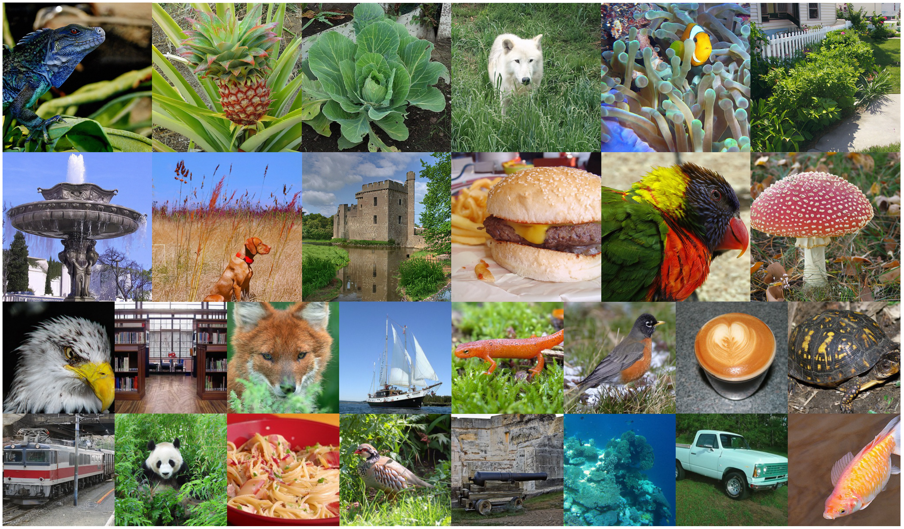
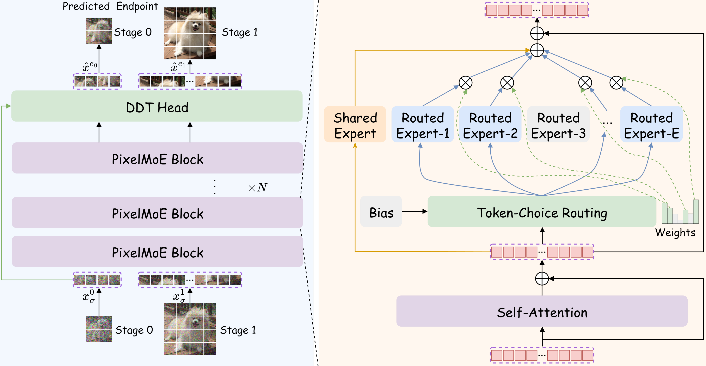

# PixelMoE: Scaling Pixel-Space Diffusion with LLM-Style Mixture-of-Experts

<div align="center">

[](https://arxiv.org/abs/2610.18857)&nbsp;
[](https://github.com/KlingAIResearch/PixelMoE)&nbsp;
[](https://huggingface.co/KlingTeam/PixelMoE)&nbsp;

</div>

This repository provides the official PyTorch implementation of **PixelMoE: Scaling Pixel-Space Diffusion with LLM-Style Mixture-of-Experts**, with training and evaluation code for class-conditional ImageNet generation at 256×256 and 512×512 resolution.

[](assets/visual.pdf)

## ⚡️ Introduction

[](assets/pixelmoe_framework.pdf)
- PixelMoE brings standard LLM-style Mixture-of-Experts to pixel-space diffusion. 
Each image token activates 4 of 32 routed experts, alongside a shared expert, with bias-based load balancing. 

- Pixel-Space Hierarchical Flow Matching generates images in two stages, first establishing the overall structure at low resolution, then refining details at the target resolution.

- PixelMoE achieves FID **1.47** at 256×256 and **1.53** at 512×512 on class-conditional ImageNet-1K, without representation alignment, or perceptual losses.

## 🪐 Installation

Clone the repository:

```bash
git clone https://github.com/KlingAIResearch/PixelMoE.git
cd PixelMoE
```

Our `pixelmoe` environment uses Python 3.12, [PyTorch](https://github.com/pytorch/pytorch) 2.9.1, CUDA 12.8, and [FlashAttention](https://github.com/Dao-AILab/flash-attention) 2.8.3. Create and activate the environment:

```bash
bash scripts/setup_env.sh
conda activate pixelmoe
```

The setup installs PyTorch, [GMuon](https://github.com/nanovisionx/gmuon), and FlashAttention.

## 🦄 Data Preparation

Prepare ImageNet-1K with images grouped into class folders:

```text
/path/to/imagenet/train/
├── n01440764/
│   ├── image_0001.JPEG
│   └── ...
├── n01443537/
│   └── ...
└── ...
```

Set the dataset path before training or evaluation:

```bash
export IMAGENET_PATH=/path/to/imagenet/train
```

## ✨ Training

We provide Base, Large, and Huge training configurations at both resolutions:

| Model | 256×256 config | 512×512 config |
|---|---|---|
| PixelMoE-B-E32A4 | [pixelmoe_b_e32a4_256.sh](configs/pixelmoe_b_e32a4_256.sh) | [pixelmoe_b_e32a4_512.sh](configs/pixelmoe_b_e32a4_512.sh) |
| PixelMoE-L-E32A4 | [pixelmoe_l_e32a4_256.sh](configs/pixelmoe_l_e32a4_256.sh) | [pixelmoe_l_e32a4_512.sh](configs/pixelmoe_l_e32a4_512.sh) |
| PixelMoE-H-E32A4 | [pixelmoe_h_e32a4_256.sh](configs/pixelmoe_h_e32a4_256.sh) | [pixelmoe_h_e32a4_512.sh](configs/pixelmoe_h_e32a4_512.sh) |

Model names follow `PixelMoE-{B/L/H}-E32A4/{8/16}`, where `E32A4` denotes 32 routed experts with 4 activated per token, and `/8` or `/16` denotes the patch size. DDT and MoE architecture settings are defined in [model_pixelmoe.py](model_pixelmoe.py).

For example, train PixelMoE-B-E32A4 at 256×256:

```bash
bash scripts/train.sh configs/pixelmoe_b_e32a4_256.sh
```

The scripts default to one node with 8 GPUs. Set `GPUS`, `NNODES`, `NODE_RANK`, and `MASTER_ADDR` for other distributed setups. Additional command-line arguments override the script settings.

**Notes:**

- **Regularization:** To reduce overfitting, Huge models enable random cropping, Gaussian input noise, and dropout in selected attention and FFN layers from epoch 200.
- **Training stability:** Following [JiT](https://arxiv.org/html/2511.13720v1#S4.SS3), we clamp the velocity denominator to a positive minimum. Our training setup additionally uses gradient clipping, skips optimizer updates when gradient norms exceed a threshold or are non-finite, and avoids sampling stage-relative sigma values near zero.

## ⛅  Evaluation

We provide pretrained checkpoints on [Hugging Face](https://huggingface.co/KlingTeam/PixelMoE).

Use the following checkpoint filenames under `checkpoints/`:

| Model | 256×256 checkpoint | 512×512 checkpoint |
|---|---|---|
| PixelMoE-B-E32A4 | `pixelmoe_b_e32a4_256.pth` | `pixelmoe_b_e32a4_512.pth` |
| PixelMoE-L-E32A4 | `pixelmoe_l_e32a4_256.pth` | `pixelmoe_l_e32a4_512.pth` |
| PixelMoE-H-E32A4 | `pixelmoe_h_e32a4_256.pth` | `pixelmoe_h_e32a4_512.pth` |

ImageNet-1K results reported in the paper:

| Model | FID ↓ at 256×256 | FID ↓ at 512×512 |
|---|---|---|
| PixelMoE-B-E32A4 | 1.88 | 2.05 |
| PixelMoE-L-E32A4 | 1.54 | 1.58 |
| PixelMoE-H-E32A4 | **1.47** | **1.53** |

For example, evaluate PixelMoE-H-E32A4 at 256×256 and specify the CFG scale, CFG interval, and sigma lower bound:

```bash
bash scripts/sample.sh configs/pixelmoe_h_e32a4_256.sh \
  checkpoints/pixelmoe_h_e32a4_256.pth outputs/samples/pixelmoe_h_e32a4_256 \
  --cfg ${CFG} --interval_min ${INTERVAL_MIN} --interval_max ${INTERVAL_MAX} \
  --sigma_min ${SIGMA_MIN}
```

Set `CFG`, `INTERVAL_MIN`, `INTERVAL_MAX`, and `SIGMA_MIN` before running this command, or omit these options to use the defaults in the selected configuration.

Evaluation generates images and computes FID and Inception Score using JiT's [torch-fidelity](https://github.com/LTH14/torch-fidelity) package and the same precomputed ImageNet reference statistics as [JiT](https://github.com/LTH14/JiT), included in [fid_stats](fid_stats) for both resolutions.

## 🙏 Acknowledgements

Our implementation builds on [JiT](https://github.com/LTH14/JiT), [FLUX](https://github.com/black-forest-labs/flux), [Pyramid Flow](https://github.com/jy0205/Pyramid-Flow), and [LightningDiT](https://github.com/hustvl/LightningDiT). Our weight initialization follows [Megatron-LM](https://github.com/NVIDIA/Megatron-LM). We use [GMuon](https://github.com/nanovisionx/gmuon) for optimization.

## 📖 Citation

If you find PixelMoE useful in your research, please cite our paper:

```bibtex
@misc{dong2026pixelmoescalingpixelspacediffusion,
  title={PixelMoE: Scaling Pixel-Space Diffusion with LLM-Style Mixture-of-Experts},
  author={Ruixiao Dong and Jianmin Bao and Bozhi Luan and Zijie Meng and Xin Tao and Pengfei Wan and Kun Gai and Li Li and Houqiang Li},
  year={2026},
  eprint={2610.18857},
  archivePrefix={arXiv},
  primaryClass={cs.CV},
  url={https://arxiv.org/abs/2610.18857},
}
```

## 📬 Contact

For questions, please contact [dongruixiao@kuaishou.com](mailto:dongruixiao@kuaishou.com).
